<h1 align="center">Hi , I'm Muh. As'ad Habib</h1>

  

  
  

  
  
  
  

##  About Me

-  **Informatics Student** at Unismuh Makassar.
-  Crafting intuitive **UI/UX designs** with Figma.
-  Deeply interested in **Cyber Security** and Network Defense.
-  Focus on building **modern, responsive, and clean** web applications.
-  Enthusiast of **MikroTik** networking and hardware maintenance.
-  Currently sharpening skills in **Java, Python, and JavaScript**.

 

##  Tech Stack & Tools

  

##  Currently Learning

  
  
  
  
  

##  GitHub Statistics

  
  

  

##  Contribution Activity

  <picture>
    <source media="(prefers-color-scheme: dark)" srcset="https://raw.githubusercontent.com/Muh-Asad-Habib/Muh-Asad-Habib/output/github-contribution-grid-snake-dark.svg" />
    <source media="(prefers-color-scheme: light)" srcset="https://raw.githubusercontent.com/Muh-Asad-Habib/Muh-Asad-Habib/output/github-contribution-grid-snake.svg" />
    
  </picture>

##  Goals

| Icon | Mission | Status |
| :---: | :--- | :---: |
|  | Build high-performance, responsive web apps | 🏗️ |
|  | Master advanced UI/UX principles | 🎨 |
|  | Obtain Cyber Security & MTCNA Certifications | 📚 |
|  | Contribute to impactful open-source projects | 🌟 |

<h3 align="center">
 Keep Learning • Keep Building • Keep Growing 
</h3>

